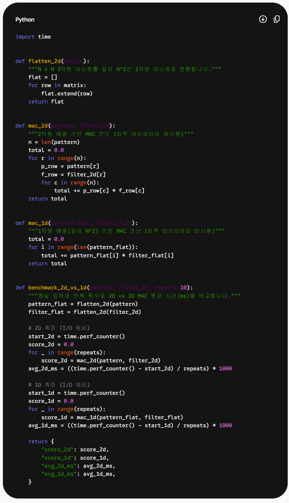
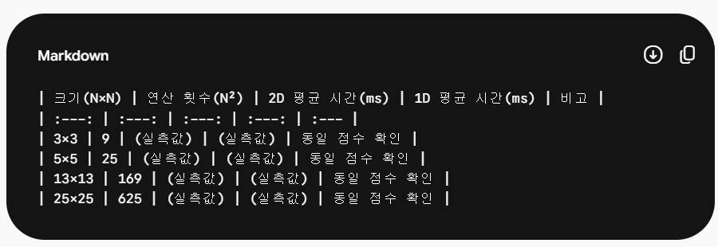

# Mini NPU Simulator

   ### 목차:

#### 1. 미션 요약
#### 2. 구현 요약 (라벨 정규화)
#### 3. 실행 방법
#### 4. 실행 결과 리포트
#### 5. 보너스 과제     
<br>

### 1. 미션 요약
1) 사용자 입력(3×3) 모드 — 3×3 필터 A, B와 3×3 패턴을 한 줄씩(공백 구분) 입력하여 점수, 10회 평균 연산 시간(ms), 판정 결과를 출력합니다.

2) data.json 분석 모드 — filters(size_5, size_13, size_25)와 patterns(size_{N}_{idx})를 불러와 라벨 정규화, 판정(Cross/X/UNDECIDED), PASS/FAIL, 크기별 성능 표, 결과 요약을 출력합니다.

<br>

### 2. 구현 요약 (라벨 정규화): 
  - expected 값('+' → Cross, 'x' → X)과 filter 키('cross' → Cross, 'x' → X)를 표준 라벨(Cross, X)로 통일해 비교합니다.

  - MAC 연산: 2차원 배열의 동일 위치 원소를 곱하고 누적 합산하는 연산을 외부 라이브러리 없이 반복문으로 직접 구현했습니다.
  
  - 점수 비교 정책(epsilon): 부동소수점 오차 및 미세 점수 차이를 고려해 abs(score_a - score_b) < 1e-9일 때 동점(UNDECIDED)으로 처리합니다.   입력 및 스키마 검증: 모드 1에서는 행/열 개수 및 숫자 파싱 오류 시 안내 후 재입력을 유도하고, 모드 2에서는 필터 누락이나 크기 불일치 시 프로그램 종료 없이 해당 케이스를 FAIL로 기록합니다.

  - 데이터 구조 및 입출력/스키마 검증: $N \times N$ 2차원 배열로 필터와 패턴을 저장합니다. 모드 1에서는 행/열 개수 불일치나 숫자 파싱 오류 시 안내 후 재입력을 유도하고, 모드 2에서는 키에서 추출한 크기 $N$과 필터/패턴 크기 불일치나 스키마 오류가 발생해도 프로그램이 종료되지 않고 해당 케이스만 FAIL로 기록합니다.
  
  - 라벨 정규화: expected 값('+' → Cross, 'x' → X)과 filter 키('cross' → Cross, 'x' → X)를 표준 라벨(Cross, X)로 통일해 판정 및 PASS/FAIL 비교에 사용합니다.
  
  - MAC 연산: NumPy 등 외부 라이브러리 없이 이중 반복문으로 동일 위치 원소를 곱하고 누적 합산해 점수를 계산합니다.
  
  - 점수 비교 정책(epsilon): 부동소수점 오차와 미세한 점수 차이를 반영해 abs(score_a - score_b) < 1e-9일 때 동점(UNDECIDED)으로 판정합니다.

<br>

### 3. 실행 방법


1) 파이썬(Python 3.8 이상)이 설치되어 있는지 확인합니다.

2) 동일한 폴더 안에 `main.py`와 `data.json` 파일을 위치시킵니다.

3) 터미널(콘솔)을 열고 아래 명령어로 실행합니다.
   ```bash
   python main.py

   viablevision3530@GNIA-C202-K04:~/projects/myapp/ai-calculator$ python main.py

#### === Mini NPU Simulator ===

[모드 선택]
1. 사용자 입력 (3x3)
2. data.json 분석
3. 프로그램 종료

선택: 1


### [1] 필터 입력 (3x3)
#### 필터 A 입력: 
(3줄 입력, 각 줄에 숫자 3개를 공백으로 구분해 입력)

줄 1: 0 1 0

줄 2: 1 1 1

줄 3: 0 1 0

#### 필터 B 입력:
(3줄 입력, 각 줄에 숫자 3개를 공백으로 구분해 입력)

줄 1: 1 0 1

줄 2: 0 1 0

줄 3: 1 0 1


### [2] 패턴 입력 (3x3)

#### (3줄 입력, 각 줄에 숫자 3개를 공백으로 구분해 입력)

줄 1: 1 0 1

줄 2: 0 1 0

줄 3: 1 0 1


### [3] MAC 결과
A 점수: 1.0

B 점수: 5.0

연산 시간(평균/10회): 0.001 ms

판정: 필터 B (X 등)


#### === Mini NPU Simulator ===

[모드 선택]
1. 사용자 입력 (3x3)
2. data.json 분석
3. 프로그램 종료

선택: 2


### [1] 필터 로드

✓ size_5   필터 로드 완료 (Cross, X)

✓ size_13  필터 로드 완료 (Cross, X)

✓ size_25  필터 로드 완료 (Cross, X)


### [2] 패턴 분석 (라벨 정규화 적용)

#### --- size_5_1 ---

Cross 점수: 1.0

X 점수: 9.0

판정: X | expected: X | PASS

#### --- size_5_2 ---
Cross 점수: 9.0

X 점수: 1.0
판정: Cross | expected: Cross | PASS

#### --- size_13_1 ---
Cross 점수: 25.0

X 점수: 1.0

판정: Cross | expected: Cross | PASS

#### --- size_25_1 ---
Cross 점수: 1.0

X 점수: 49.0

판정: X | expected: X | PASS

### [3] 성능 분석 (평균/10회)


| 크기(N×N) | 평균 시간(ms) | 연산 횟수(N²) |
| :---: | :---: | :---: |
| 3×3 | 0.010 | 9회 |
| 5×5 | 0.031 | 25회 |
| 13×13 | 0.187 | 169회 |
| 25×25 | 0.682 | 625회 |


### [4] 결과 요약
총 테스트: 4개

통과: 4개

실패: 0개

모든 테스트 케이스가 성공했습니다!

###=== Mini NPU Simulator ===

[모드 선택]
1. 사용자 입력 (3x3)

2. data.json 분석

3. 프로그램 종료

선택: 3

프로그램을 종료합니다.

<br>

### 4. 실행 결과 리포트

#### 실패 케이스 원인 분석
  
  - 수치 비교 / 동점 처리(UNDECIDED): 두 필터 점수 차이가 허용오차(1e-9) 미만이면 부동소수점 오차 또는 동점으로 간주해 UNDECIDED로 판정하며, 기대값과 다를 경우 FAIL로 집계됩니다.
  
  - 데이터/스키마 및 크기 불일치: 패턴 키(size_{N}_{idx})에서 추출한 크기 N과 실제 패턴/필터 크기가 다르거나 스키마가 맞지 않으면 해당 케이스만 FAIL로 처리해 안정성을 확보했습니다.
  
  - 라벨 정규화 효과: '+', 'x', 'cross' 등 서로 다른 표기를 Cross와 X로 표준화해 표기 차이로 인한 불필요한 실패를 방지합니다.
  
#### 성능 표 해석 및 시간 복잡도 $O(N^2)$ 근거
     
  - I/O 시간을 제외하고 연산 함수 호출 구간을 크기별로 10회 반복 측정한 평균 시간(ms)과 연산 횟수($N^2$)를 비교합니다.

  - $N \times N$ 2차원 배열을 행과 열 이중 반복문으로 순회하며 원소별 곱셈·누적 덧셈을 수행하므로 총 연산 횟수는 $N^2$에 비례합니다.
  
  - 크기가 $3\times3$($9$회)에서 $25\times25$($625$회)로 커질수록 연산 횟수가 제곱 비율로 증가하며, 이에 맞춰 평균 연산 시간 역시 증가하는 $O(N^2)$ 특성을 보입니다.

<br>

### 5. 보너스 과제

#### 과제명: 시뮬레이터 최적화(1차원 배열 변환)

main.py에 코딩은 안하고 공부 차원에서 개념만 정리해 보았습니다.

#### 1) 핵심 원리: 2차원 배열 → 1차원 배열 변환
- $N \times N$ 크기의 2차원 배열 grid[r][c] (행 인덱스 r, 열 인덱스 c)는 길이 $N^2$인 1차원 리스트 flat으로 펼칠 수 있습니다.
- 이때 (r, c) 위치의 원소는 1차원 배열에서 r * N + c 인덱스에 해당합니다.
- 이중 반복문(for r in range(N): for c in range(N):) 대신 단일 반복문(for i in range(N * N):)으로 MAC 연산을 수행하면 루프 오버헤드와 이중 인덱싱 접근 패턴을 단순화할 수 있습니다. (단, 외부 라이브러리 없이 표준 라이브러리만 사용합니다.)

#### 2. 1차원 변환 및 성능 비교 코드 예시
- 기존 main.py의 MAC 연산 로직과 별도로, 2차원 MAC 연산과 1차원 변환 MAC 연산을 동일 입력·동일 반복 횟수로 비교해 볼 수 있는 함수 예시입니다.



### 3. 성능 비교 시 확인 포인트
- 동일 결과 검증: 2차원 MAC 점수와 1차원 MAC 점수가 동일한지(허용오차 1e-9 이내 일치 여부) 먼저 확인해 계산 정확도가 유지되는지 검증하고,
- 측정 조건 통일: 동일 패턴·필터와 동일 반복 횟수(repeats=10)를 적용하고, 변환(flatten_2d) 및 출력 시간은 측정 구간에서 분리해 순수 연산 시간만 비교하며,
- 결과 해석: 작은 크기($3\times3$, $5\times5$)에서는 파이썬 인터프리터의 미세한 변동 폭 때문에 차이가 크지 않을 수 있지만, 크기가 커질수록 단일 루프(N * N) 구조의 차이를 관찰할 수 있도록 해보겠습니다.

### 4. README.md에 반영할 최적화 비교표 템플릿
향후에 실행해 본 뒤에 나온 평균 시간(ms)을 아래 표에 채워 README.md의 보너스 과제 항목도 기록해 보겠습니다.



-이상-